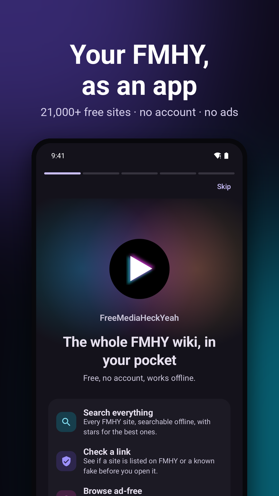
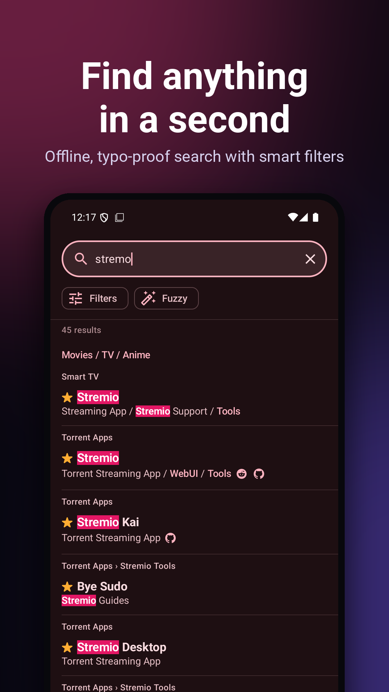
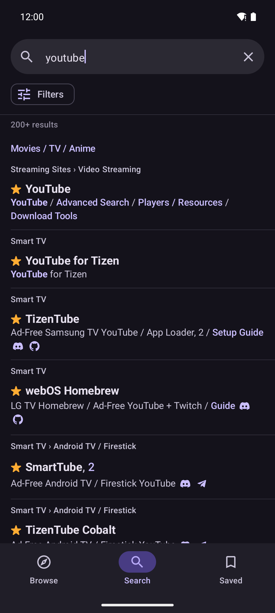
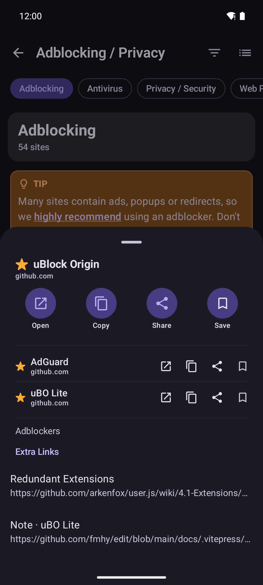
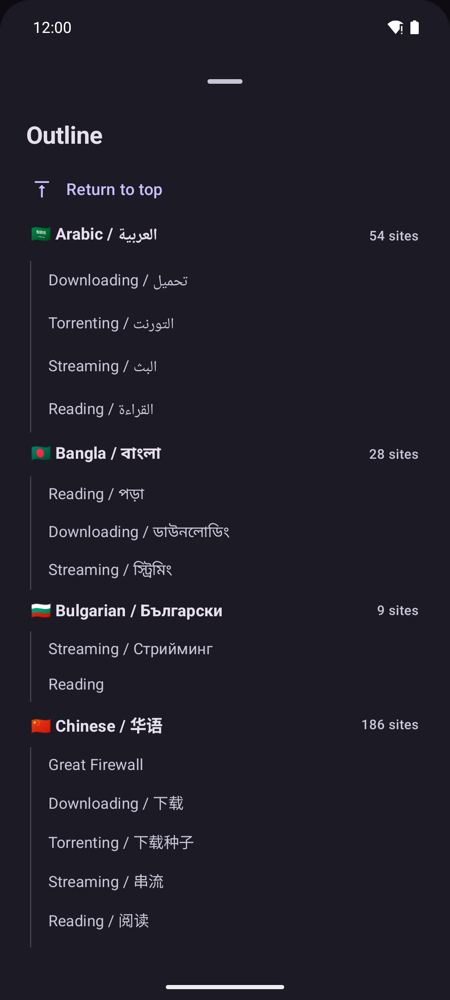
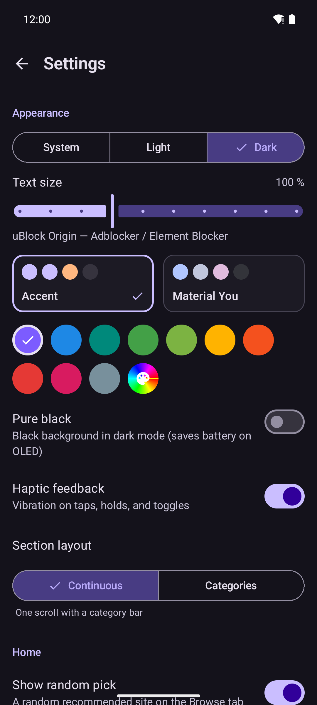

<div align="center">


# FMHY for Android

[](https://kotlinlang.org/)
[](https://github.com/omeg4-dev/fmhy-android/releases/latest)
[](https://github.com/omeg4-dev/fmhy-android/commits/main)
[](https://github.com/omeg4-dev/fmhy-android/releases)
[](https://github.com/omeg4-dev/fmhy-android/stargazers)
[](https://github.com/omeg4-dev/fmhy-android/blob/main/LICENSE)

**The entire FMHY wiki on your phone. Works offline, includes an ad-blocking browser, and checks links before you open them.**

[**⬇ Download APK**](https://github.com/omeg4-dev/fmhy-android/releases/latest) · Android 8.0+ · Free & Open Source · No Ads or Tracking

</div>

<p align="center">
  
  
  
</p>

## Features

- 🔍 **Fast offline search** across 21,000+ links. Handles typos automatically and supports filters like `in:video anime`, `is:starred`, or `site:github.com`.
- 🛡️ **Built-in browser** with uBlock Origin/EasyList filter lists, pop-up blocking, unsafe-site warnings, and quick access to mirrors or Wayback Machine if a site is down.
- 🔗 **Link checker**: Share or paste any URL to see if it's listed on FMHY, starred, or a fake clone.
- 🔔 **Changelog & notifications**: See what was recently added, removed, or starred. Follow specific categories to get notified when they update.
- ⬇️ **Download manager** with pause/resume and optional VirusTotal or Hybrid Analysis scans (requires your own free API key).
- 🎨 **Customizable**: Light, dark, and AMOLED themes, Material You support, home screen widgets, and shareable bookmark folders.
- 🔒 **Private**: No accounts, no tracking, and no middleman servers.

<p align="center">
  
  
  
</p>

<details>
<summary><b>More details (Search, Browser & Privacy)</b></summary>

**Search & Reading**
- Fuzzy search catches typos (like `stremo` for `stremio`), or you can switch to exact match. Starred sites rank higher.
- Keeps the exact layout, icons, and stars from fmhy.net. Tap an entry to view mirrors and extra links, or hold to open directly.
- Includes the beginner's guide, FAQs, and automatic base64 decoding.

**Browser**
- Address bar badge shows if the current site is listed or starred on FMHY.
- Supports tab groups, private tabs, picture-in-picture, video speed controls, and double-tap to seek.

**Privacy & Data**
- The app pulls markdown directly from [fmhy/edit](https://github.com/fmhy/edit) (with jsDelivr as a fallback) and parses it locally on your device.
- Release APKs come bundled with the wiki so it works offline right away, only downloading diffs when updating.
- VirusTotal / Hybrid Analysis checks are completely opt-in and only run when you add your own API key.
</details>

## Install

Download the latest APK from [**Releases**](https://github.com/omeg4-dev/fmhy-android/releases/latest). 

*Note: If you're updating from a version older than `0.4.0`, uninstall the old version first (the signing key changed).*

## Building

```bash
./gradlew :app:assembleRelease      # unsigned unless a release keystore is configured
./gradlew :core:data:test :app:testDebugUnitTest

```

* `app/` — Android UI (Kotlin, Compose)
* `core/data/` — Parser, SQLite, sync, search, ad-block
* `pipeline/` — Python reference parser for tests
* `tools/` — Icon and store-frame scripts

See `THIRD_PARTY.md` for third-party assets and credits (filter lists from uBlock/EasyList, link checks based on [FMHY SafeGuard](https://github.com/fmhy/FMHY-SafeGuard), changelog data via [fmhy-tracker](https://fmhy-tracker.pages.dev/)).

## Disclaimer

This is an unofficial fan project. Site listings are managed by the FMHY team—submit site suggestions at [fmhy.net](https://fmhy.net/other/contributing) and report app bugs in our [issue tracker](https://github.com/omeg4-dev/fmhy-android/issues). Licensed under GPL-3.0-or-later.

Built with the help of AI coding assistants. I design the features and review everything, but AI wrote a good chunk of the code. If you spot a bug, please open an issue!

```

```
