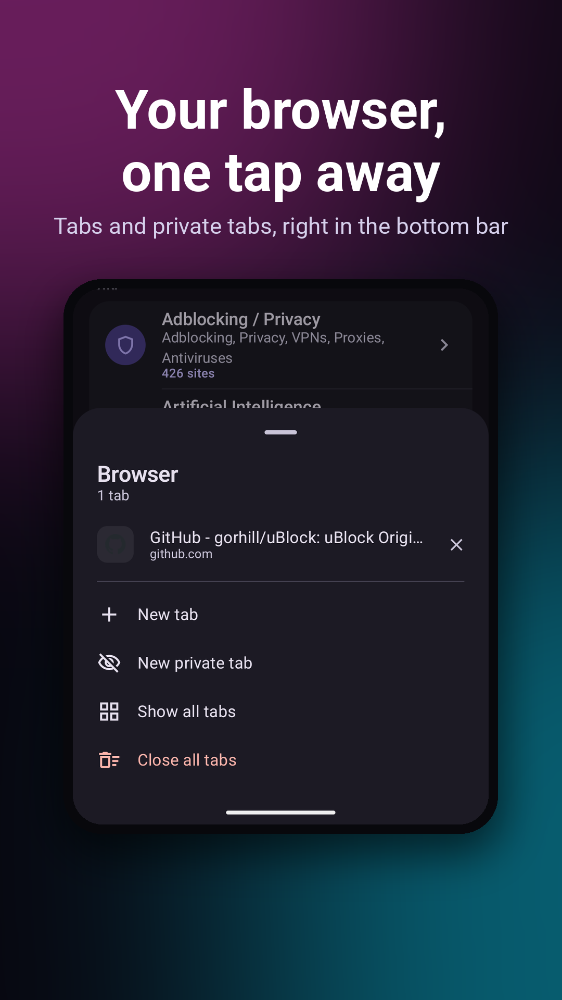
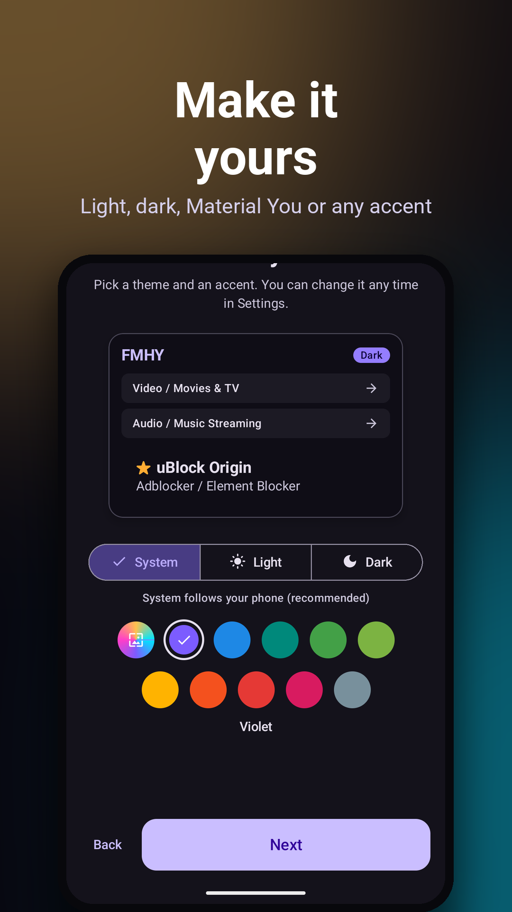

<div align="center">


# FMHY for Android

[](https://github.com/omeg4-dev/fmhy-android/releases/latest)
[](https://github.com/omeg4-dev/fmhy-android/commits/main)
[](https://github.com/omeg4-dev/fmhy-android/releases)
[](https://github.com/omeg4-dev/fmhy-android/stargazers)
[](https://github.com/omeg4-dev/fmhy-android/blob/main/LICENSE)


**The whole FMHY wiki in your pocket: faster than the website, safer than a random browser, and it works offline.**

Over 21,000 hand-picked free sites for streaming, downloading, reading, gaming, ad blocking and more,
in a native app that keeps up with every change for you.

[**⬇ Download the latest APK**](https://github.com/omeg4-dev/fmhy-android/releases/latest) · Android 8.0+ · free & open source · no account · no ads · no tracking

</div>

<p align="center">
  
  
  
  
</p>

---

## Why use the app instead of the website?

### ⚡ Find anything in a second
- **Instant search over every site on FMHY**, offline, as you type.
- **Typo-proof**: fuzzy search finds `stremio` even when you type `stremo`. Switch to exact when you know what you want.
- **Search like a pro**: `in:video anime`, `is:starred adblock` or `site:github.com`. Parameters turn into tidy pills, and the app suggests sections, filters and sites as soon as you type `in:`, `is:` or `site:`.
- **The best matches first**: the 3 most fitting categories on top, starred picks ranked higher, and the matching words highlighted, even when they're in the link or the category.

### 🛡️ Browse without the junk
- **A built-in browser with real ad blocking**, powered by uBlock Origin's and EasyList's own filter lists.
- **Pop-ups and forced redirects stopped** before they hijack your tab.
- **Know where you are**: a small icon in the address bar tells you when a page is starred or listed on FMHY, so you can see at a glance that you're on the real site.
- **Unsafe sites get a warning** before they load, based on FMHY's unsafe-sites list.
- **Site down? One tap** gets you a mirror, the Wayback Machine or an alternative from the same category.
- Tabs that stay organised (list or grid, private tabs kept apart), video in picture-in-picture, playback speed and double-tap to seek.

### 🔗 Check any link before you click it
- Paste or share a link from **any app** and see right away whether it's on FMHY, starred, or a known fake lookalike.
- Shows **exactly where on FMHY** the site is listed, with one tap to that spot.

### 🔔 Never miss what changed
- **What's new**: every site added, starred, removed, renamed or moved, by day, week or month, and searchable.
- **Follow the sections you care about** and get one quiet notification when FMHY adds or stars something there.
- **Your saved sites are watched**: you hear when one is starred, removed or moved, and removed ones come with replacements.

### 📌 Make it yours
- **Save sites with one swipe**, sort them into folders and share a list with friends.
- **Your look**: light, dark or pure black, Material You or your own accent colour, adjustable text size.
- A home-screen widget, launcher shortcuts, a Random pick to discover something new, and several app icons.

### 🔒 Private by design
- **No account, no ads, no tracking, no server of ours.** The app reads the wiki straight from FMHY's own repository.
- **Works offline**: the release APK ships with the whole wiki built in, and updates only download what changed.
- Hidden base64 links on FMHY are decoded for you.

---

## Everything FMHY has, the way FMHY has it

- Every section in the same order as fmhy.net, with the same stars and icons.
- One row per line of the wiki: tap for every site on that line with its mirrors and extra links, hold to open it.
- The beginner's guide, notes, FAQ and FMHY's posts, readable in the app.

<p align="center">
  
  
  
  
</p>

## Download

Get the APK from [**Releases**](https://github.com/omeg4-dev/fmhy-android/releases/latest) (Android 8.0 or newer).
A short setup on first start lets you pick your look, how links open and which sections to follow.

If you installed a build older than 0.4.0, uninstall it first: those were signed with a different key.

## How it works

There's no server of ours in between. The app downloads the wiki's markdown straight from
[fmhy/edit](https://github.com/fmhy/edit) (jsDelivr as a fallback) and parses it on your phone. Each sync
checks which files changed and only downloads those. Everything is stored locally.

Change history comes from fmhy/edit itself and, for the last month, from
[fmhy-tracker](https://fmhy-tracker.pages.dev/). The browser's filter lists come from uBlock Origin's and
EasyList's own servers. Link checks use the same lists as [FMHY SafeGuard](https://github.com/fmhy/FMHY-SafeGuard).

Release APKs include a copy of the wiki, so they work offline from the first launch. Builds made straight
from this repo download the wiki the first time they start.

## Building

```bash
./gradlew :app:assembleRelease      # unsigned unless a release keystore is configured
./gradlew :core:data:test :app:testDebugUnitTest
```

- `app/`: the Android app (Kotlin, Jetpack Compose)
- `core/data/`: pure-JVM data layer (Kotlin parser, SQLite, sync, search, ad-block engine)
- `schema/`: dataset schema
- `pipeline/`: Python reference parser, only used for parity tests
- `tools/`: icon conversion (`svg2vd.py`), store screenshot frames (`store-frames.py`); third-party assets are listed in `THIRD_PARTY.md`

More detail on the architecture and build is in `STATUS.md`.

## Not affiliated with FMHY

This is a fan project, not made by the FMHY team. Which sites get listed is up to them: suggestions for the
wiki go to [fmhy.net](https://fmhy.net/other/contributing), problems with the app go to the
[issue tracker](https://github.com/omeg4-dev/fmhy-android/issues).

License: GPL-3.0-or-later.

## Made with AI

This app was built with the help of AI coding assistants. I decide what it
does and review the changes, but a large part of the code was written by AI.
If you find a bug or something odd, please open an issue.
