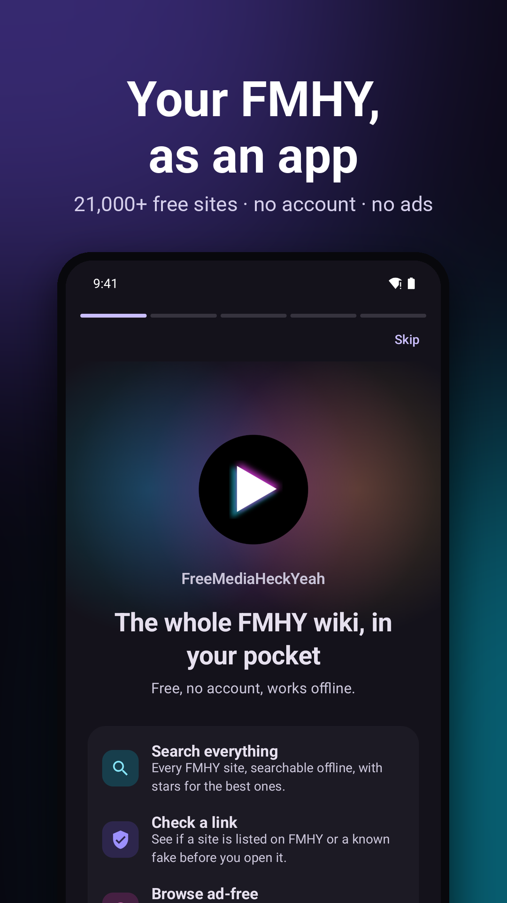
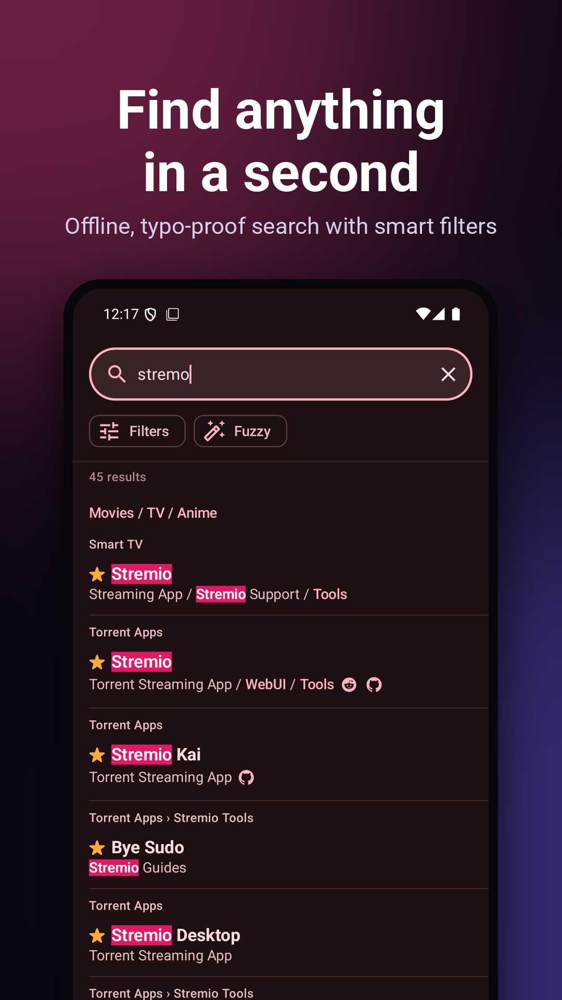
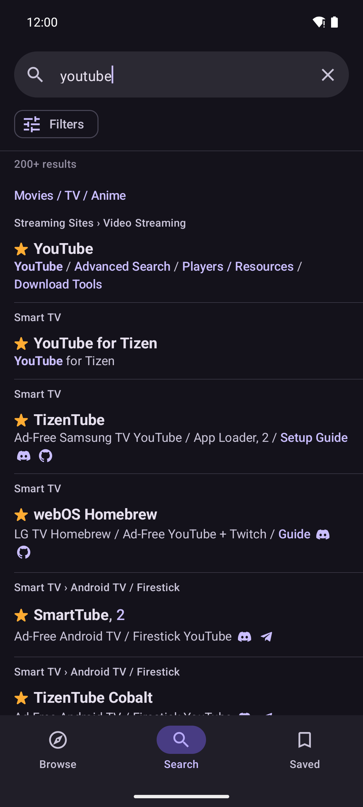
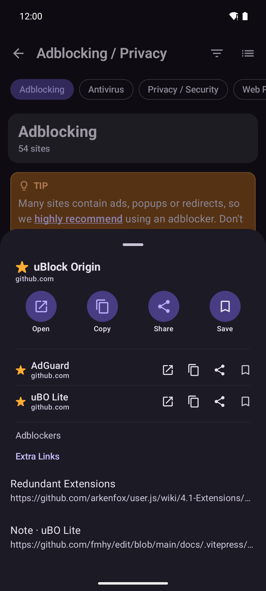
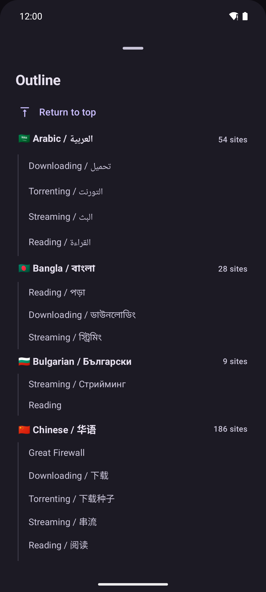
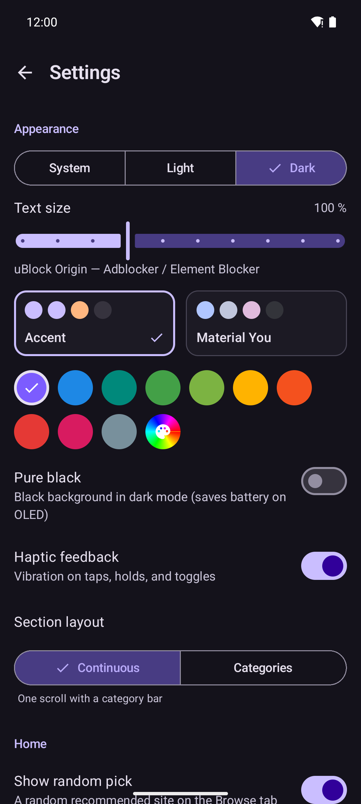

<div align="center">


# FMHY for Android

[](https://kotlinlang.org/)
[](https://github.com/omeg4-dev/fmhy-android/releases/latest)
[](https://github.com/omeg4-dev/fmhy-android/commits/main)
[](https://github.com/omeg4-dev/fmhy-android/releases)
[](https://github.com/omeg4-dev/fmhy-android/stargazers)
[](https://github.com/omeg4-dev/fmhy-android/blob/main/LICENSE)


**The whole FMHY wiki in your pocket: searchable, offline, and safer to browse.**

[**⬇ Download the APK**](https://github.com/omeg4-dev/fmhy-android/releases/latest) · Android 8.0+ · Free & Open Source · No ads · No tracking

[](https://fmhy.net/misc#indexes)

</div>

<p align="center">
  
  
  
</p>

## ✨ Why choose it

- 📴 **Offline from the first launch.** The release APK ships with the wiki already inside, and updates only download what changed.
- ⚡ **Find anything in a second.** Search covers 21,900+ sites, forgives typos (`stremo` finds `stremio`) and understands filters like `in:video anime`, `is:starred` or `site:github.com`.
- 🛡️ **Safety built in.** Every link can be checked against FMHY's lists, with warnings for unsafe sites and clones before you open them.
- 🌐 **A browser that works for the wiki.** Ad and tracker blocking, pop-up and redirect blocking, tabs and a status badge showing whether the current site is on FMHY.
- 🔒 **Private by design.** No accounts, no analytics and no servers of ours in between. The app reads FMHY's public repository directly.

## 🧰 Features

### 📚 Wiki and search
- Keeps the layout, icons and stars of fmhy.net. Tap an entry to see every site on that line with mirrors and extra links; hold it to open directly.
- Fuzzy or exact matching, with starred sites ranked higher. Bookmarks stay put when the wiki changes and can be shared.
- Includes the beginner's guide and FAQs, and decodes base64-hidden links for you.

### 🛡️ Safety
- **Link checker:** share or paste any URL to see whether it is listed on FMHY, starred, or a known fake clone, using the [FMHY SafeGuard](https://github.com/fmhy/FMHY-SafeGuard) list.
- Warnings before unsafe sites and before APK or EXE downloads.
- Optional **VPN-only mode** blocks browsing while no VPN is active.

### 🌐 Browser
- uBlock Origin / EasyList filter lists, cookie-banner hiding and optional third-party cookie blocking.
- Tab groups, private tabs, picture-in-picture, per-site video speed and double-tap to seek.
- **Dead-site rescue:** when a page fails to load, the app offers mirrors and alternative links.

### ⬇️ Downloads
- Download manager with pause and resume.
- Optional VirusTotal and Hybrid Analysis scans. They run only if you add your own free API key.

### 🔔 Changelog and notifications
- See what was recently added, removed or starred, and follow categories to get notified when they change.
- **App update notifications** check for new releases in the background (every 6 hours to weekly, your choice).

### 🎨 Make it yours
- Light, dark and pure-black themes, Material You or your own accent colour, adjustable text size.
- Home screen widgets and a choice of alternative app icons.
- Backup and restore of your settings and bookmarks.

<details>
<summary><b>🔍 More details: data and privacy</b></summary>

- The app pulls markdown directly from [fmhy/edit](https://github.com/fmhy/edit) (with jsDelivr as a fallback) and parses it locally on your device.
- Release APKs come bundled with the wiki so it works offline right away; later syncs only download the diff.
- VirusTotal and Hybrid Analysis checks are opt-in and only run when you add your own API key.
- App update checks look for new releases of this repository on GitHub; switch them off any time under Settings → App updates.
</details>

<p align="center">
  
  
  
</p>

## 📲 Install

Download the latest APK from [**Releases**](https://github.com/omeg4-dev/fmhy-android/releases/latest) and open it on your phone (Android 8.0 or newer). The app updates in place and can notify you when a new version is out.

*Note: If you're updating from a version older than `0.4.0`, uninstall the old version first (the signing key changed).*

## 🔧 Building

```bash
./gradlew :app:assembleRelease      # unsigned unless a release keystore is configured
./gradlew :core:data:test :app:testDebugUnitTest
```

* `app/` — Android UI (Kotlin, Compose)
* `core/data/` — Parser, SQLite, sync, search, ad-block
* `pipeline/` — Python pipeline that builds the wiki snapshots and change history from fmhy/edit
* `tools/` — Icon and store-frame scripts

See `THIRD_PARTY.md` for third-party assets and credits (filter lists from uBlock/EasyList, link checks based on [FMHY SafeGuard](https://github.com/fmhy/FMHY-SafeGuard), changelog data via [fmhy-tracker](https://fmhy-tracker.pages.dev/)).

## ⚠️ Disclaimer

This is an unofficial fan project. Site listings are managed by the FMHY team—submit site suggestions at [fmhy.net](https://fmhy.net/other/contributing) and report app bugs in our [issue tracker](https://github.com/omeg4-dev/fmhy-android/issues). Licensed under GPL-3.0-or-later.

Built with the help of AI coding assistants. I design the features and review everything, but AI wrote a good chunk of the code. If you spot a bug, please open an issue!
