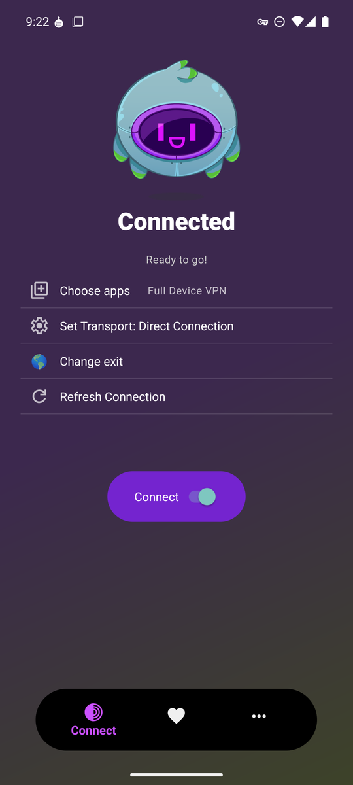
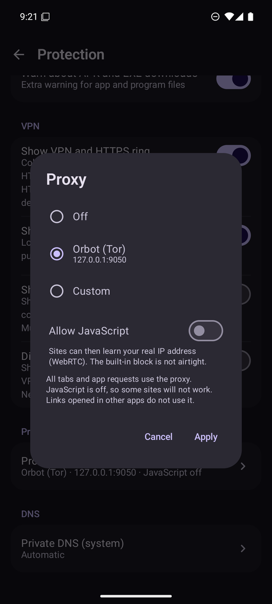
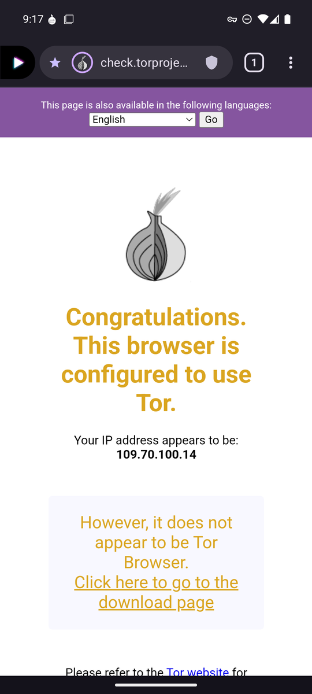
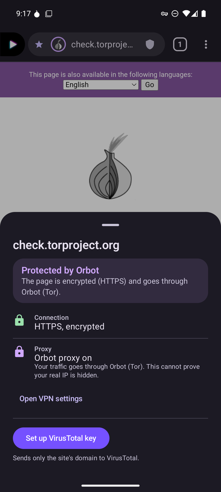
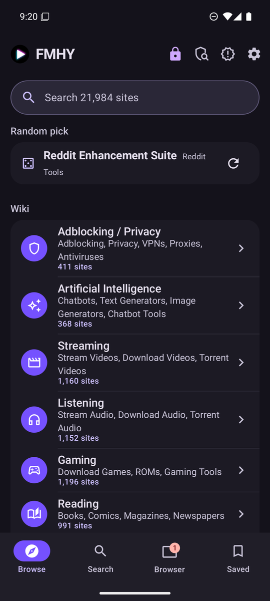

# Use FMHY for Android over Tor with Orbot

This sends everything the app does (all browser tabs, wiki sync, downloads, update checks) through the [Tor network](https://www.torproject.org/), so sites see a Tor address instead of yours. It takes about 5 minutes to set up.

## What you need

- **FMHY for Android 1.4.0 or newer.**
- **Orbot**, the Tor app by the Guardian Project: from [Google Play](https://play.google.com/store/apps/details?id=org.torproject.android), [orbot.app](https://orbot.app), [GitHub](https://github.com/guardianproject/orbot-android/releases), or F-Droid with the Guardian Project repository switched on.
- An up-to-date **Android System WebView** (update it in your app store).

## Setup

### 1. Start Orbot

1. Open Orbot and tap **Connect**.
2. Android asks to set up a VPN connection. Tap **OK**.
3. Wait until Orbot says **Connected**.

### 2. Turn on the proxy in FMHY

1. Open FMHY and tap the gear icon.
2. Go to **Protection** and scroll to **Proxy**.
3. Choose **Orbot (Tor)** and tap **Apply**.

Leave **Allow JavaScript** off. Read [JavaScript](#javascript) before you change it.

### 3. Check that it works

Open `https://check.torproject.org` in the FMHY browser: paste it into the address bar. The page should say **Congratulations. This browser is configured to use Tor.** The extra line saying it is not Tor Browser is expected.

The ring around the site icon is **purple**. Tap it to see the details.

  &nbsp;&nbsp;
  

## What the colours mean

| Ring colour | Meaning |
|---|---|
| Purple | Encrypted page (HTTPS), sent through Orbot |
| Green | Encrypted page, sent through a VPN |
| Amber | Encrypted page, but the site sees your own IP address |
| Red | Page is not encrypted (HTTP), with or without Orbot |

The ring is on by default (**Settings > Protection > Show VPN and HTTPS ring**). You can also show a lock icon on the Home screen with **Show VPN icon on Home**; it turns purple too.

Purple means the Orbot proxy is **selected** in FMHY. It does not prove that Orbot is running. If Orbot stops, pages show **Cannot connect through Orbot** and nothing is sent outside Tor.

## Keep your other VPN (optional)

Android allows only one VPN at a time. To keep using another VPN, run Orbot as a proxy only:

1. In Orbot, switch **Connect** off.
2. Open the **More** tab (three dots), then **Orbot Settings > General**, and turn on **Power User Mode**.
3. Go back to the first tab and tap **Connect**.
4. Orbot asks for the **Alarms & reminders** permission, which keeps it running in the background. Allow it, go back and tap **Connect** again.
5. If Orbot warns about battery optimisation, tap **Disable Battery Optimizations** so Android does not close it.

Then connect your other VPN and keep the FMHY proxy on **Orbot (Tor)**.

## Other way: let Orbot's VPN cover FMHY

You can leave the FMHY proxy **Off** and let Orbot do all the work:

1. In Orbot (Power User Mode off), tap **Choose apps** and tick **FMHY**. Without a choice, Orbot covers the whole device.
2. Tap **Connect**, or **Refresh Connection** if Orbot is already connected.

The ring in FMHY is then **green**, because Android reports an ordinary VPN. Check the connection on `https://check.torproject.org`.

The difference: with the FMHY proxy on, the app refuses to connect when Orbot is not running. With the proxy off, switching Orbot off sends your traffic over your normal connection.

## Good to know

- **Slower.** Tor is much slower than a normal connection, especially for video and downloads.
- **Blocked sites.** Some sites block Tor or ask for many captchas.
- **Other apps are not covered.** A link you open in another browser or app does not use the FMHY proxy.
- **Google Safe Browsing** is off while a proxy is set.
- **Backups** do not include the proxy. Set it again after restoring a backup or moving to a new phone.
- **Disable browsing without VPN** still needs a real VPN. If you use Orbot in Power User Mode without another VPN, turn that setting off.
- Tor hides your IP address. It does not make you anonymous if you sign in to accounts or share personal details.

### JavaScript

While the proxy is on, JavaScript is off, so some sites will not work. You can switch on **Allow JavaScript** in the Proxy dialog, but sites can then learn your real IP address (through WebRTC). The built-in block is not airtight. Leave it off if hiding your IP matters.

## Problems

| What you see | What to do |
|---|---|
| **Cannot connect through Orbot** | Open Orbot and check that it says **Connected**, then tap **Retry** in FMHY. |
| It still fails while Orbot is connected | Look at the **SOCKS Port** on Orbot's **More** tab. If it is not 9050, choose **Custom** in FMHY: **SOCKS5**, host `127.0.0.1`, and that port. The ring does not turn purple with a custom proxy. |
| Orbot never finishes connecting | Your network may block Tor. In Orbot, tap **Set Transport** and try a bridge. |
| The Proxy setting is greyed out | Update **Android System WebView**. Very old versions cannot use a proxy. |
| A page is blank or broken | It probably needs JavaScript. See [JavaScript](#javascript). |

## Turn it off

In FMHY go to **Settings > Protection > Proxy**, choose **Off** and tap **Apply**. Then switch Orbot off.

---

*Checked with Orbot 17.9.6. Button names can differ in other Orbot versions.*
